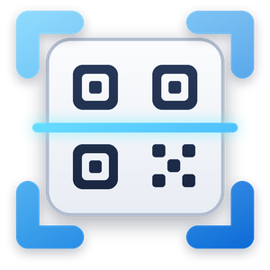
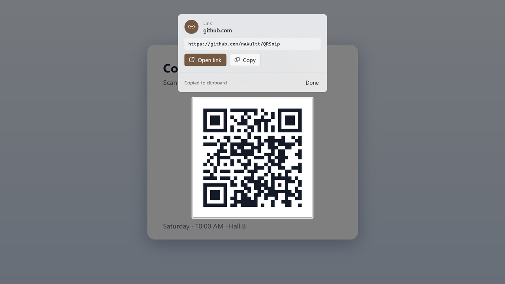
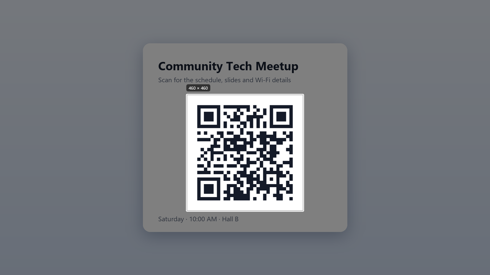
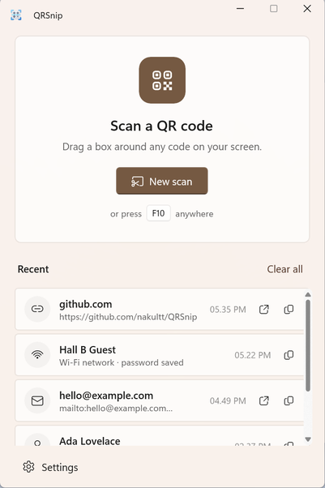

<div align="center">



# QRSnip

**Snipping Tool, but for QR codes.** Press <kbd>F10</kbd>, drag a box around any QR code on your screen, and get the link instantly.

[](https://github.com/nakultt/QRSnip/actions/workflows/ci.yml)
[](https://github.com/nakultt/QRSnip/releases/latest)
[](LICENSE)




</div>

## Why

QR codes show up everywhere on a PC: in slides, PDFs, video calls, web pages and chat screenshots. Your phone can't easily scan your own monitor. QRSnip reads them where they are, without screenshots or uploads.

## Features

- **Snip to scan.** A frozen, dimmed view of your desktop just like Snipping Tool. Drag a box, or click once to scan the whole screen.
- **Instant result card.** Shows next to your selection with **Open link**, **Copy** and, for Wi-Fi codes, **Copy password**.
- **Understands what it reads.** Links, Wi-Fi, email, phone, SMS, contacts (vCard/MeCard) and map locations, plus plain text.
- **Several codes at once.** Every code inside the box is decoded. Tiny and inverted (light-on-dark) codes work too.
- **Global shortcut.** <kbd>F10</kbd> by default; switch to <kbd>Ctrl</kbd>+<kbd>F10</kbd>, <kbd>Win</kbd>+<kbd>Shift</kbd>+<kbd>Q</kbd> or <kbd>Ctrl</kbd>+<kbd>Alt</kbd>+<kbd>Shift</kbd>+<kbd>Q</kbd> in Settings.
- **Lives in the tray.** Closing the window keeps the shortcut working. Optional start with Windows.
- **History**, stored only on your device. Wi-Fi passwords are never shown in the list.
- **Multi-monitor and mixed-DPI aware.** Covers every display, crisp at any scaling.
- **Native Windows 11 look.** WinUI 3, Mica, Fluent icons, light and dark theme, your accent colour.
- Supports QR codes, plus Data Matrix, Aztec and PDF417.

<p align="center">
  
  &nbsp;
  
</p>

## Install

| | |
|---|---|
| **Microsoft Store** | Coming soon. |
| **Portable** | Download `QRSnip-<version>-win-x64-portable.zip` (or `arm64`) from [Releases](https://github.com/nakultt/QRSnip/releases/latest), unzip anywhere and run `QRSnip.exe`. No install or runtime needed. |

Requires Windows 10 version 2004 (build 19041) or later, x64 or ARM64.

## Usage

| Action | How |
|---|---|
| Start a scan | <kbd>F10</kbd> anywhere, **New scan** in the app, or tray icon › *Scan QR code* |
| Scan an area | Drag a box around the code |
| Scan a whole screen | Click once without dragging |
| Open the link | **Open link** or <kbd>Enter</kbd> |
| Copy the text | **Copy** or <kbd>Ctrl</kbd>+<kbd>C</kbd> |
| Cancel | <kbd>Esc</kbd> or right-click |

You can also start a scan from a shortcut or script with `QRSnip.exe --scan` (`qrsnip --scan` when installed from the Store).

## Privacy

QRSnip works entirely offline. Screen captures are kept in memory only while you select an area and are never saved or sent anywhere. Scan history and settings are stored locally in `%LOCALAPPDATA%\QRSnip` and can be cleared or turned off in Settings. Links open only when you click **Open link**. See [PRIVACY.md](PRIVACY.md).

## Build from source

Prerequisites: Windows 10/11, [.NET 10 SDK](https://dotnet.microsoft.com/download/dotnet/10.0). Visual Studio 2026 with the *WinUI application development* workload is optional.

```powershell
git clone https://github.com/nakultt/QRSnip.git
cd QRSnip

# Run the tests
dotnet test --project tests/QRSnip.Core.Tests

# Build and run the app unpackaged
dotnet build src/QRSnip -c Debug -p:Platform=x64 -p:Portable=true
./src/QRSnip/bin/x64/Debug/net10.0-windows10.0.26100.0/win-x64/QRSnip.exe

# Release artifacts: portable zips + Store bundle in ./artifacts
./build/package.ps1
```

### Project layout

```
src/QRSnip.Core/     QR decoding (ZXing.Net) and payload classification. No UI, fully unit-tested
src/QRSnip/          WinUI 3 app: main window, capture overlay, tray icon, global shortcut
tests/               xUnit v3 tests for QRSnip.Core
build/               package.ps1 (release artifacts), generate-assets.py (icon + MSIX tiles)
docs/                README images, Store listing assets, publishing guide
```

Built with WinUI 3 / Windows App SDK 2.x on .NET 10, using [ZXing.Net](https://github.com/micjahn/ZXing.Net) for decoding.

## Releasing

1. Bump `Version` in `Directory.Build.props` and `Identity/@Version` in `src/QRSnip/Package.appxmanifest`, and update [CHANGELOG.md](CHANGELOG.md).
2. Publish a GitHub release tagged `vX.Y.Z`. The [release workflow](.github/workflows/release.yml) builds the packages, attaches the portable zips to the release and keeps the Store bundle as a workflow artifact.
3. Upload the `.msixupload` to Partner Center. See [docs/PUBLISHING.md](docs/PUBLISHING.md).

## Roadmap

Planned work, in the order it will be built (see [milestones](https://github.com/nakultt/QRSnip/milestones)):

1. [#1](https://github.com/nakultt/QRSnip/issues/1) Fix cursor flicker while dragging (v1.0.1)
2. [#2](https://github.com/nakultt/QRSnip/issues/2) System tray and background running polish (v1.1.0)
3. [#3](https://github.com/nakultt/QRSnip/issues/3) Installable app: Microsoft Store, winget, signed MSIX (v1.1.0)
4. [#4](https://github.com/nakultt/QRSnip/issues/4) Full screen scan mode (v1.2.0)
5. [#5](https://github.com/nakultt/QRSnip/issues/5) Scan from image files: open, drag and drop, paste (v1.2.0)
6. [#6](https://github.com/nakultt/QRSnip/issues/6) Scan with the camera (v1.3.0)

## Contributing

Issues and pull requests are welcome. Please run the tests before opening a PR, and keep UI changes consistent with the Windows 11 design language.

## License

[MIT](LICENSE) © 2026 Nakul T
